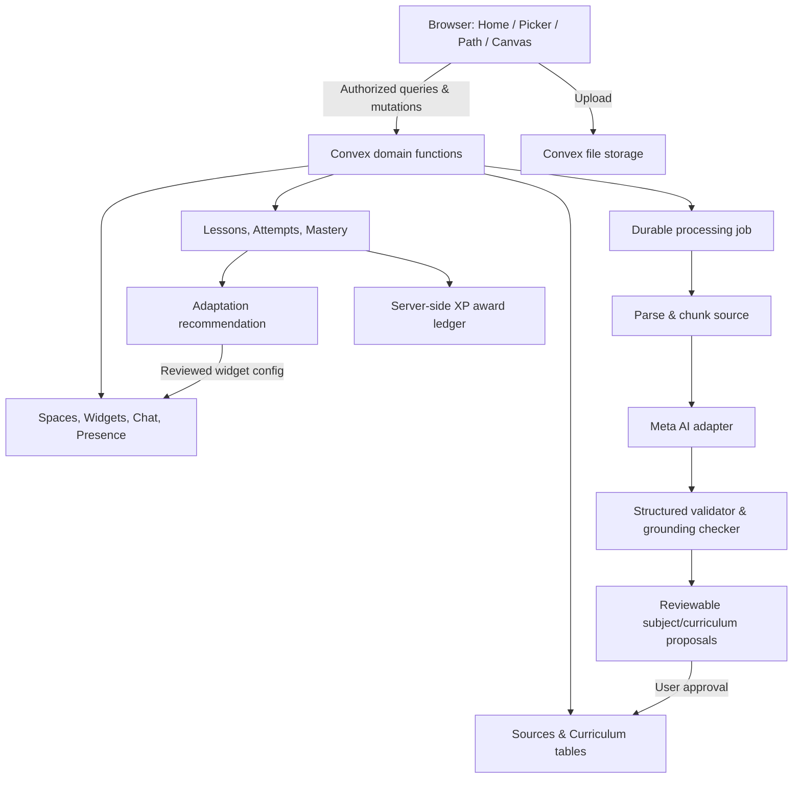

# Technical architecture — vertical slices and system boundaries

## Stack

**Client:** React + TypeScript + Vite. **Backend:** Convex database, auth, storage, reactive queries/mutations/actions and durable workflow components. **AI:** Meta model access through server-side provider adapter with strict JSON schema validation. **Infra:** separate PearNotes deployments, secure file storage, error logging, CI. **Initial source handling:** PDF/text; add specialized parsers later. Model availability/pricing requires testing with actual event credits.

## Architectural invariants

1. All writes go through server authorization; no client-supplied owner ID is authoritative.
2. Curriculum lesson/activity records are separate from widgets and their coordinates.
3. Source segment links are stable, even when curriculum version changes.
4. Personal `attempts` and `mastery` never live in shared widget JSON.
5. AI outputs are **proposals** or validated typed specs; model isn't trusted with permission decisions, reward balances or arbitrary code.
6. Side effects use idempotency keys. An import retry cannot create duplicate subjects/rewards.
7. Real-time high-churn presence isolated from stable educational records to avoid unnecessary fan-out.
8. Group AI retrieval uses a separate authorization-scoped knowledge boundary from personal Pear Tutor.

## Domain services

| Service | Server responsibility | UI consumer |
|---|---|---|
| Auth & Identity | auth sessions, user profile, avatar, limits | Shell/Profile |
| Workspace | spaces/group membership/invites, authorization | Groups/Lesson shell |
| Source Intake | upload ref, parse, extraction jobs, metadata | Subject wizard/Library |
| Classification | suggest subjects and segment assignments | Review step |
| Curriculum | versioned sections/units/lessons/objectives | Path drawer |
| Lesson Composer | validated activity specs, positions, sources | Lesson canvas |
| Assessment | submit attempt, rubric, confidence, feedback | Challenge/Teach-Back |
| Mastery & Adaptation | objective evidence, next activity proposal | Compass/Tutor |
| Pear Tutor | scoped grounding, chat threads, controlled tools | Bottom dock |
| Rewards | eligible events, idempotent XP, trophies | Header/Shelf |
| Collaboration | messages, presence, move locks, notes promotion | Shared rooms |

## Recommended vertical delivery

A slice includes client UI, typed contract, Convex function, privacy guard, telemetry and test. Build in dependency order: identity→source→subject review→curriculum→lesson→attempt→adaptation→reward→group. Avoid building a dozen backend modules with no usable screens.

## Data lifecycle

Every source has lifecycle `uploaded / parsing / indexed / failed / deleted`. Subject proposal `pending / user_edited / accepted / rejected`; curriculum version `draft / published / superseded`; lesson `generated / validated / published / retired`. Attempts immutable; progress is derived/projected from evidence. Soft deletions preserve referential integrity until eventual retention policy cleanup.

## Model adapter

Expose `extractConcepts(input,modelVersion)`, `proposeSubjects(segments)`, `proposeCurriculum(concepts)`, `composeLesson(objectives)`, `evaluateTeachBack(answer,rubric,sources)`, `generateHint(context)`, `proposeRemediation(evidence)`. Provider-specific APIs and authentication remain behind this interface. Apply schema parsing, rate-limits, timeouts, retries, budgets and prompt-injection isolation.

## Deployment boundaries

`dev`, `preview`, `prod`; separate secrets, storage, data and model quotas. Hosted model requests originate from Convex actions or a secure service, never with API keys in browser code. Include an evaluation/demo account segregated from user onboarding.
